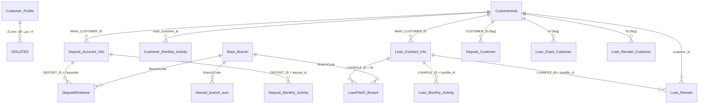

# نقشه‌ی روابط جداول (ERD) — Alzahra_Final_DB

تاریخ: 2026-08-28

## ⚠️ یافته‌ی بحرانی: `Customer_Profile` از بقیه‌ی دیتابیس جدا است

قبل از طراحی روابط، در حین اعتبارسنجی کلیدها مشخص شد که ستون `Customer_Profile.Customer_id` **تقریباً هیچ تطابقی** با شناسه‌ی مشتری استفاده‌شده در ۵ جدول دیگر ندارد — با وجود نوع داده‌ی کاملاً یکسان (`numeric(38,0)`) و توزیع طول رقم مشابه در هر دو طرف؛ گزینه‌های ساده (cast نادرست، truncate، پیشوند اضافه) به‌طور مشخص رد شد.

| جفت | نرخ تطابق |
|---|---|
| `Customer_Profile.Customer_id` ↔ `Deposit_Accoutnt_Info.MAIN_CUSTOMER_ID` | ۱۲ / ۷۰۶,۵۰۹ (~۰٪) |
| `Customer_Profile.Customer_id` ↔ `Loan_Remain_Customer.ID` | ۴ / ۷۱۸,۱۳۶ (~۰٪) |
| مشتریان حقوقی (`real_or_legal = حقوقی`) | **۰ / ۳۸,۴۷۷ — تطابق کاملاً صفر** |

در مقابل، ۵ جدول زیر با هم یک فضای شناسه‌ی واحد و سازگار دارند (۹۵-۱۰۰٪ تطابق زوجی):
`Customer_Monthly_Activity`, `Deposit_Accoutnt_Info`, `Loan_Contract_Info`, `Loan_Remain`, `Deposit_Customer` (+ جداول پرچمی `Loan_Grant_Customer`, `Loan_Remain_Customer`).

**تصمیم گرفته‌شده با کاربر (2026-08-28):** فعلاً بدون داده‌ی جمعیت‌شناختی (`Customer_Profile`) پیش می‌رویم. این جدول در نمودار زیر به‌عنوان **جزیره‌ی مجزا** نشان داده شده و در View های فاز ۱ استفاده نمی‌شود. اگر در آینده جدول نگاشت (`Customer_id` ↔ شناسه‌ی مشترک) از بانک دریافت شد، به‌راحتی قابل اتصال است.

---

## نمودار روابط (بخش قابل‌استفاده — ۱۳ جدول)

> `CustomerHub` یک موجودیت منطقی است (فضای شناسه‌ی مشترک بین ۵+۲ جدول بالا)، نه یک جدول واقعی — چون خودِ `Customer_Profile` که باید نقش «جدول مرکزی مشتری» را بازی کند، از این فضا جدا افتاده است.

---

## جدول کامل کلیدها (تأییدشده با کوئری روی کل داده)

| از | به | نوع رابطه | پوشش |
|---|---|---|---|
| `Customer_Monthly_Activity.main_customer_id` | `CustomerHub` | many-to-one | خودِ فضای مرجع |
| `Deposit_Accoutnt_Info.MAIN_CUSTOMER_ID` (nvarchar) | `CustomerHub` | many-to-one | خودِ فضای مرجع (نیاز به `LTRIM/RTRIM` + cast) |
| `Deposit_Monthly_Activity.deposit_id` | `Deposit_Accoutnt_Info.DEPOSIT_ID` | many-to-one | ⚠️ ۴۷,۱۶۳,۰۱۶ از ۱۲۸,۸۱۶,۵۳۵ ردیف orphan (~۳۷٪) — نیاز به بررسی EDA بیشتر، احتمالاً حساب‌های حذف/آرشیوشده |
| `Deposit_Monthly_Activity.customer_id` | `CustomerHub` | many-to-one | مستقیم (خودِ فضای مرجع) |
| `Loan_Contract_Info.MAIN_CUSTOMER_ID` (bigint) | `CustomerHub` | many-to-one | خودِ فضای مرجع |
| `Loan_Monthly_Activity.loanfile_id` | `Loan_Contract_Info.LOANFILE_ID` | many-to-one | ✅ ۱۰۰٪ (۰ orphan از ۱۹,۰۵۰,۱۷۹) |
| `Loan_Remain.loanfile_id` | `Loan_Contract_Info.LOANFILE_ID` | many-to-one | ⚠️ ۴۰,۷۸۶,۴۱۷ از ۷۶,۷۴۲,۵۳۶ orphan (~۵۳٪) — نیاز به بررسی (شاید LOANFILE_ID های بسته‌شده/آرشیوی که در Contract_Info دیگر نیستند) |
| `Loan_Remain.customer_id` | `CustomerHub` | many-to-one | مستقیم |
| `Deposit_Customer.CUSTOMER_ID` | `CustomerHub` | flag/subset | مستقیم |
| `Loan_Grant_Customer.ID` | `CustomerHub` | flag/subset | مستقیم |
| `Loan_Remain_Customer.ID` | `CustomerHub` | flag/subset | مستقیم |
| `DepositIDInterest.Depositid` | `Deposit_Accoutnt_Info.DEPOSIT_ID` | many-to-one | ✅ ۱۰۰٪ (۰ orphan از ۳۹,۹۵۸,۸۳۲) |
| `DepositIDInterest.BranchCode` | `Base_Branch.BranchCode` | many-to-one | ✅ ۱۰۰٪ |
| `LoanFileID_Brnach.ID` | `Loan_Contract_Info.LOANFILE_ID` | many-to-one | ✅ ۱۰۰٪ |
| `LoanFileID_Brnach.BranchCode` | `Base_Branch.BranchCode` | many-to-one | ✅ ۱۰۰٪ پس از رفع (نیاز به `REPLACE(...,CHAR(13),'')` — شرح در پایین) |
| `Interset_branch_sum.BranchCode` | `Base_Branch.BranchCode` | many-to-one | تقریباً کامل (۵۹ orphan از ۲۵,۹۲۴) |
| `Customer_Profile.creator_branch` | `Base_Branch.ID` | many-to-one | ✅ ۹۹.۴٪ (۴,۵۴۶ orphan از ۷۱۸,۱۳۶) |

### ✅ حل شد: چرا `LoanFileID_Brnach.BranchCode` ↔ `Base_Branch.BranchCode` صفر تطابق نشان می‌داد
بررسی با `LEN()`/`ASCII()` علت را پیدا کرد: هر مقدار `BranchCode` در `LoanFileID_Brnach` یک کاراکتر مخفی `CHAR(13)` (Carriage Return، مربوط به ناسازگاری خط پایان فایل هنگام Export توسط بانک) در انتها دارد — مثلاً طول ظاهری `"3302"` در واقع ۵ کاراکتر است. `LTRIM/RTRIM` معمولی این کاراکتر را پاک نمی‌کند. **راه‌حل:** همه‌جا قبل از Join روی این ستون از `REPLACE(BranchCode, CHAR(13), '')` (به‌همراه `LTRIM/RTRIM`) استفاده شود. با این اصلاح، تطابق کامل برقرار است.

---

## اصل طراحی View ها بر مبنای این نقشه
- همه‌ی View های فاز ۱ حول محور **`CustomerHub`** (شناسه‌ی مشترک ۵+۲ جدول عملیاتی) ساخته می‌شوند، **نه** `Customer_Profile`.
- شعبه (`Base_Branch`) تنها بُعد جمعیت‌شناختی/جغرافیایی قابل‌اتکا برای فاز ۱-۳ خواهد بود تا وقتی مشکل `Customer_Profile` حل شود.
- `ECO_SEC` در `Loan_Remain` بُعد بخش اقتصادی را برای مشتریان تسهیلات‌گیرنده پوشش می‌دهد (مستقل از `Customer_Profile`).
